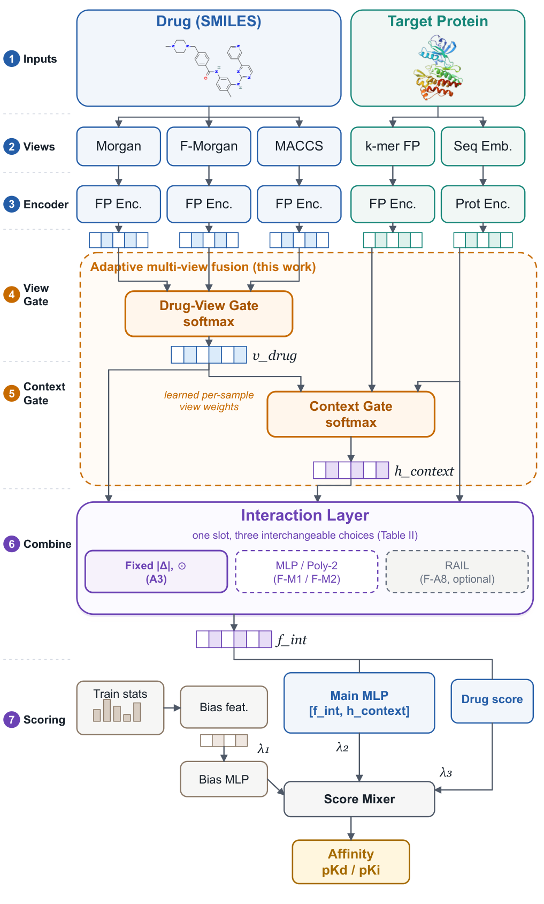

<h1 align="center">AMF-DTA</h1>

<p align="center">
  <b>Adaptive Multi-view Fusion Network for Drug-Target Affinity Prediction</b><br>
  <sub>ICASSP 2027 submission &middot; code, data and result artefacts</sub>
</p>

<p align="center">
  
  
  
  
</p>

<p align="center">
  
</p>

---

## Key finding

**A post-hoc ablation overstates what a gating mechanism contributes.**

Zeroing a trained model's gates to a constant `1/K` degrades RMSE in all 15
(seed, dataset) pairs — a median **+21.0%**. Retraining the *same*
architecture from scratch under those weights, which removes the gates from
training rather than from an already-trained model, loses a median **+0.9%**.
The two arms differ only in whether gates were present during training, so a
post-hoc intervention of this kind overstates gating's architectural value by
**~24×**.

The comparison is **state-matched**: both arms are evaluated on
best-validation checkpoints, and the gated arm is required to reproduce the
post-hoc arm's own recorded baseline to within `1.4e-6` RMSE. Comparing a
post-hoc delta taken from one checkpoint against a retrained delta taken from
another is the specific error this repository exists to rule out — the
protocol gap between those states (2.8–4.0%) is larger than the effect being
measured (~1.6%).

The paper also reports **negative results**, and they are kept visible here:

- The gated model shows **no significant advantage** over a tuned no-gate
  baseline (0.7–0.8%, two-sided paired Wilcoxon `p = 0.15`);
- A DTA adaptation of rational (RAN) interactions is **statistically
  indistinguishable** from fixed hand-designed terms (bounded within ±1.3%,
  `p = 0.28`), and a parameter-matched lightweight MLP improves on it.

## Repository layout

The layout **mirrors the original working tree on purpose**: every analysis
and audit script resolves its inputs by relative path from its own location
(`__file__.parent.parent / "outputs"`), so a script moved to a different depth
would silently read the wrong directory. The shape is preserved for that
reason, not for tidiness.

Two directories are renamed, and that is the *only* difference from the tree
the numbers came from. `rail_dta/` becomes `core/` — nothing imports that name,
so the rename is free. The model package inside it becomes `framework/`, which
scripts *do* import, so its rename carries a matching import rewrite. The edit
is mechanical and is checked rather than asserted: `package_release.py` applies
the same text transformation to each source file and requires the shipped bytes
to match, so any edit beyond the package name fails the build. Documentation
prose that names the source tree's own paths (`rail_dta/outputs/`) is
deliberately left alone — it describes where artefacts land in the tree the
numbers came from.

```
assets/                      rendered figures for this README
data/{davis,kiba,metz}/      benchmarks: smiles / sequence / affinity
outputs/                     result JSON+CSV, baseline and architecture rows
core/
  outputs/                   result JSON+CSV, AMF-DTA runs
  framework/                 model, modules, data pipeline, ensemble
  *.py                       training drivers, analyses and audits
autoresearch/
  outputs/                   JSON evidence: Table II upper group (a1–a6),
                             parameter-count ablations, cold-start runs
  figures/                   figure sources
dta_experiment/              framework: data, training loop, metrics
models/                      model implementations (imported by the framework)
configs/                     YAML experiment configurations
```

## Installation

```bash
git clone https://github.com/xwtxbzz/AMF-DTA.git
cd AMF-DTA
pip install -r requirements.txt
```

`requirements.txt` merges the framework's and the rail tree's manifests.
`torch-geometric` and `rdkit` are needed only by the graph-input and
fingerprint-input models respectively; the audits need neither a GPU nor
either of them.

## Reproducing the paper's numbers

The audits recompute every claimed value from the recorded artefacts. **No
GPU and no checkpoints are required** — the JSON and CSV under `outputs/`
are the complete evidence. The manuscript itself is *not* part of this
repository, so the checks that read the paper's text print a single `[skip]`
line and the total is 196 rather than 210; every check that reads the
artefacts alone still runs. Run from the repository root:

```bash
# PYTHONPATH is the repository root, not core/: audit_architecture.py
# imports the `dta_experiment` package, which lives at the root. Without it
# that audit does not fail -- it prints one `[skip]` line, exits 0, and the
# total silently drops from 196 to 192.
PYTHONPATH=. python core/audit_paper_numbers.py

# Which numeric literals in the paper are not pinned by any check.
PYTHONPATH=. python core/audit_coverage.py

# The headline ratio, recomputed from the raw per-pair rows.
PYTHONPATH=. python core/_verify_headline_arithmetic.py

# Regenerate the values quoted in the manuscript from the artefact.
PYTHONPATH=. python core/_emit_claim_from_artifact.py
```

The last two read the manuscript's own text and so need it present:
`audit_coverage.py` degrades to a single `[skip]` line without it, while
`_emit_claim_from_artifact.py` stops with `no manuscript found` — pass the
`.tex` path as an argument to point it at a copy elsewhere.

The scripts prefixed with `_` are deliberately *independent*
re-derivations: they recompute the headline statistics from the raw per-pair
rows rather than trusting the stored summary a second time.
`audit_paper_numbers.py` checks the manuscript against the artefact; these
check the artefact against itself, which is the one link an audit of that
shape cannot cover.

## Training from scratch

Checkpoints are excluded from this bundle (~12 GB). To regenerate any single
run:

```bash
python -m dta_experiment.train --config configs/{dataset}_{model}.yaml
```

The five-seed sweeps are driven by `core/run_*.py` and the root-level
scripts below, with `MAX_PARALLEL = 3` and resume support. Expect the full
sweep to take GPU-days.

## Datasets

| Benchmark | Drugs | Targets | Pairs | Label scale |
|---|---:|---:|---:|---|
| Davis | 68 | 442 | 30,056 | pKd |
| KIBA | 2,111 | 229 | 118,254 | KIBA score |
| Metz | 1,423 | 170 | 35,259 | pKd |

Each directory holds three CSVs — `smiles.csv` (drug id to SMILES),
`sequence.csv` (target id to sequence) and `affinity.csv` (drug, target,
value). A repetition seed sets both the random 8:1:1 partition and the
initialization, so every method sees the same split at a given seed and all
comparisons are **paired** over the 15 (seed, dataset) pairs at seeds
{42, 52, 62, 72, 82}.

## Verification

The three audits report **196 checks, 0 mismatched** in total —
`audit_paper_numbers.py` 160, `audit_baseline_rows.py` 32 and
`audit_architecture.py` 4 (32 + 4 + 160 = 196). The count is the guard, not
decoration: a repository missing one input does not error, it silently
*skips* checks, so an unchanged total is the signal that every input arrived.
The 14 manuscript-reading checks account for the difference from the 210 the
full working tree produces.

## What is not included, and why

| Excluded | Size | Reason |
|---|---|---|
| `*.pt` checkpoints | ~12 GB | Regenerable by training; read by no audit |
| training logs | — | Superseded by `history.csv` / `test_metrics.json` |
| `data/{chembl,bdb,ttd}_csv` | 3.6 GB | Used by no experiment in the paper |
| `autoresearch/outputs/**/*.csv` | 161 MB | Prediction dumps with no reader in the chain; the JSON summaries beside them carry every value the audits check |

## Citation

Provisional — replace with the published entry once available:

```bibtex
@inproceedings{wang2026amfdta,
  title     = {AMF-DTA: Adaptive Multi-view Fusion Network for
               Drug-Target Affinity Prediction},
  author    = {Wang, Zhensong and Sun, Yuwei and Wang, Juan},
  booktitle = {IEEE International Conference on Acoustics, Speech and
               Signal Processing (ICASSP)},
  year      = {2027},
  note      = {Under review}
}
```

## License

**No license has been chosen yet.** Until a `LICENSE` file is added, the
default applies: all rights reserved, and no permission is granted to reuse
this code. Add one before making the repository public.

## Authors

- **Zhensong Wang**, **Yuwei Sun**, **Juan Wang** (corresponding) —
  Inner Mongolia University, Hohhot, China

## Root-level drivers

Sweep drivers and utilities that live at the top level:

- `check_status.py`
- `compile_all_results.py`
- `generate_model_configs.py`
- `run_2024_models_5seeds.py`
- `run_2025_2026_models_5seeds.py`
- `run_all_experiments.py`
- `run_edta_resume.py`
- `run_graphdta_attentiondta_5seeds.py`
- `run_missing_5seeds_200.py`
- `run_missing_baselines_5seeds.py`
